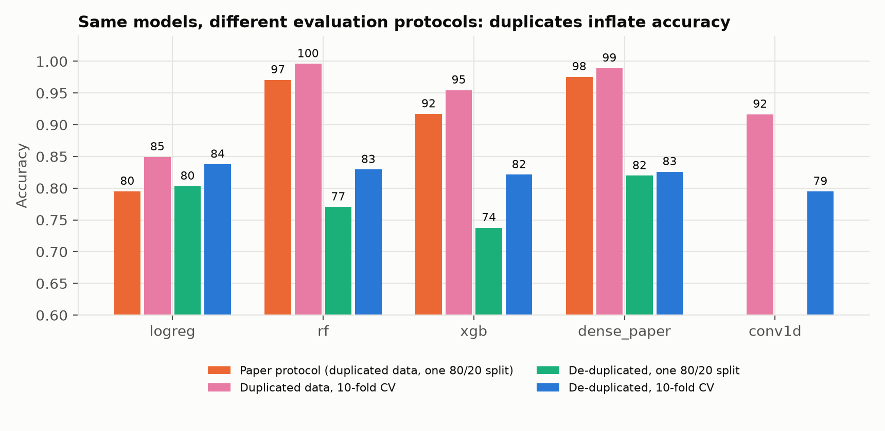
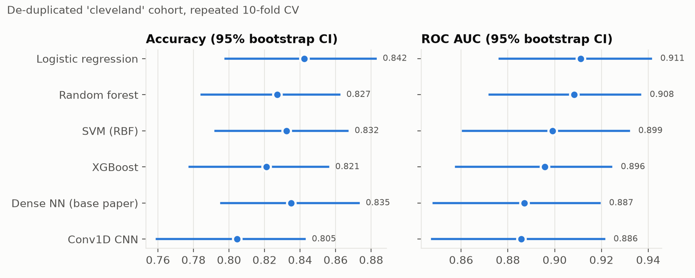
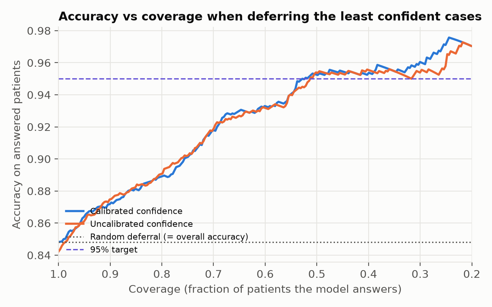
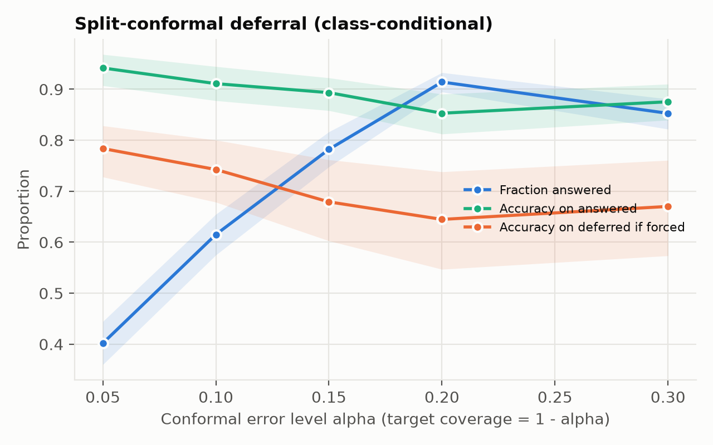
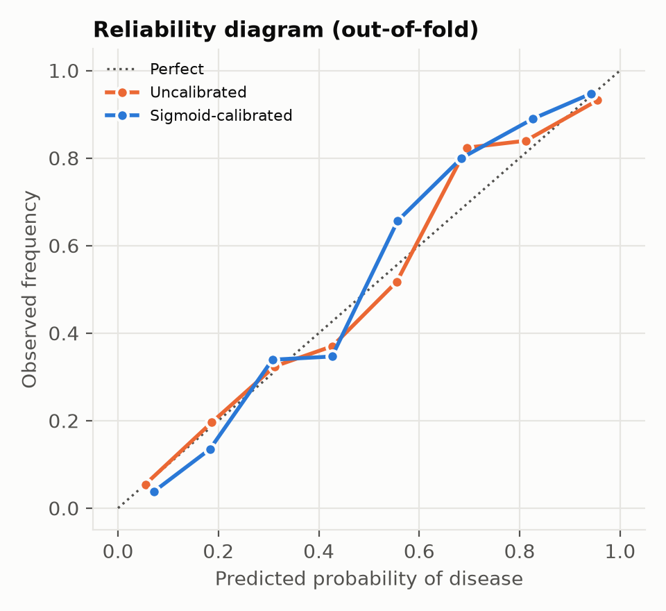
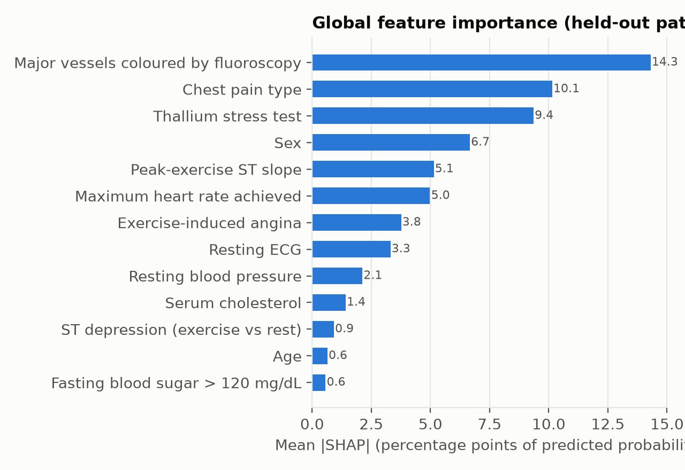
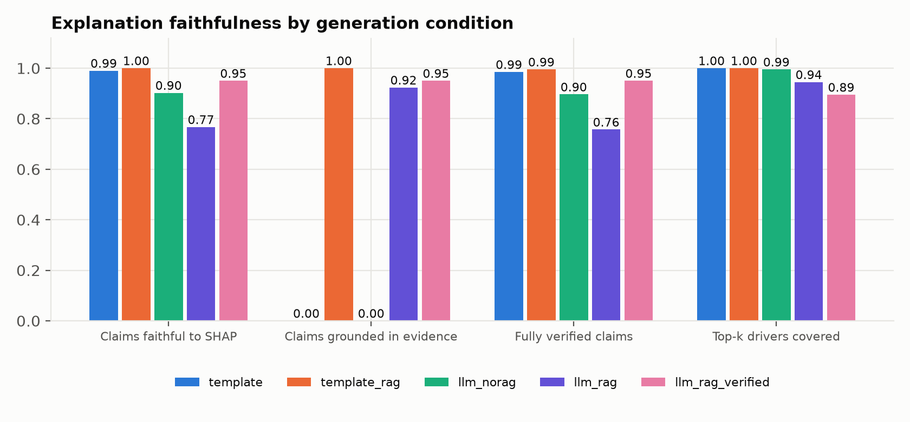

# LeakFree-Heart - experiment results

Data source: `uci`; patients after de-duplication: 918; sites: cleveland, hungarian, switzerland, va. Run mode: full.

## E1 Leakage audit of the base-paper protocol

- The public Kaggle copy has **1025 rows but only 302 unique patients** (70.5% duplicate rows; one record appears up to 8 times).
- On the paper's 80/20 split, **199 of 205 test rows (97.1%) have an identical copy in the training set.**

Accuracy under the paper protocol, split by whether the test row has a copy in training:

| model | overall | on_rows_with_copy_in_train | on_unseen_rows | n_unseen |
|---|---|---|---|---|
| logreg | 0.795 | 0.789 | 1.000 | 6.000 |
| rf | 0.971 | 0.985 | 0.500 | 6.000 |
| xgb | 0.917 | 0.930 | 0.500 | 6.000 |
| dense_paper | 0.976 | 0.990 | 0.500 | 6.000 |

All protocols:

| protocol | model | n_test | accuracy | accuracy_sd | auc |
|---|---|---|---|---|---|
| Paper protocol (duplicated data, one 80/20 split) | logreg | 205 | 0.795 |  |  |
| Paper protocol (duplicated data, one 80/20 split) | rf | 205 | 0.971 |  |  |
| Paper protocol (duplicated data, one 80/20 split) | xgb | 205 | 0.917 |  |  |
| Paper protocol (duplicated data, one 80/20 split) | dense_paper | 205 | 0.976 |  |  |
| De-duplicated, one 80/20 split | logreg | 61 | 0.803 |  |  |
| De-duplicated, one 80/20 split | rf | 61 | 0.770 |  |  |
| De-duplicated, one 80/20 split | xgb | 61 | 0.738 |  |  |
| De-duplicated, one 80/20 split | dense_paper | 61 | 0.820 |  |  |
| Duplicated data, 10-fold CV | logreg | 1025 | 0.849 | 0.028 | 0.925 |
| De-duplicated, 10-fold CV | logreg | 302 | 0.838 | 0.051 | 0.910 |
| Duplicated data, 10-fold CV | rf | 1025 | 0.996 | 0.008 | 1.000 |
| De-duplicated, 10-fold CV | rf | 302 | 0.829 | 0.047 | 0.910 |
| Duplicated data, 10-fold CV | xgb | 1025 | 0.955 | 0.025 | 0.991 |
| De-duplicated, 10-fold CV | xgb | 302 | 0.821 | 0.059 | 0.895 |
| Duplicated data, 10-fold CV | dense_paper | 1025 | 0.989 | 0.020 | 0.994 |
| De-duplicated, 10-fold CV | dense_paper | 302 | 0.826 | 0.059 | 0.900 |
| Duplicated data, 10-fold CV | conv1d | 1025 | 0.917 | 0.025 | 0.977 |
| De-duplicated, 10-fold CV | conv1d | 302 | 0.795 | 0.058 | 0.878 |



## E2 Leakage-free benchmark (primary cohort, repeated stratified CV)

Mean [95% bootstrap CI], %, except Brier/ECE.

| model_name | accuracy | auc | sensitivity | specificity | brier | ece |
|---|---|---|---|---|---|---|
| Logistic regression | 84.2 [80.0, 88.2] | 91.1 [87.7, 94.2] | 79.4 [72.4, 85.7] | 88.3 [83.4, 92.6] | 0.116 [0.093, 0.140] | 0.051 |
| SVM (RBF) | 83.2 [79.1, 87.1] | 89.9 [86.2, 93.4] | 79.1 [72.4, 85.4] | 86.7 [81.5, 91.3] | 0.123 [0.100, 0.147] | 0.049 |
| Random forest | 82.7 [78.5, 86.5] | 90.8 [87.4, 93.8] | 78.6 [71.5, 84.8] | 86.2 [81.0, 90.9] | 0.123 [0.104, 0.144] | 0.062 |
| XGBoost | 82.1 [78.0, 86.0] | 89.6 [85.8, 92.8] | 77.4 [70.4, 83.6] | 86.1 [81.1, 90.9] | 0.131 [0.104, 0.159] | 0.067 |
| Dense NN (base paper) | 83.5 [79.5, 87.3] | 88.7 [84.9, 92.1] | 78.8 [72.1, 85.0] | 87.4 [82.8, 91.7] | 0.130 [0.105, 0.157] | 0.066 |
| Conv1D CNN | 80.5 [76.2, 84.4] | 88.6 [84.8, 91.9] | 76.3 [69.7, 82.2] | 84.0 [78.6, 88.9] | 0.135 [0.111, 0.160] | 0.043 |

Pairwise AUC comparison (Nadeau-Bengio corrected t, Holm):

| model_a | model_b | mean_diff | t | p_raw | p_holm | significant_0.05 |
|---|---|---|---|---|---|---|
| logreg | svm | 0.013 | 1.271 | 0.210 | 1.000 | False |
| logreg | rf | 0.004 | 0.437 | 0.664 | 1.000 | False |
| logreg | xgb | 0.017 | 1.769 | 0.083 | 1.000 | False |
| logreg | dense_paper | 0.014 | 1.508 | 0.138 | 1.000 | False |
| logreg | conv1d | 0.025 | 2.169 | 0.035 | 0.524 | False |
| svm | rf | -0.009 | -1.048 | 0.300 | 1.000 | False |
| svm | xgb | 0.004 | 0.384 | 0.703 | 1.000 | False |
| svm | dense_paper | 0.002 | 0.111 | 0.912 | 1.000 | False |
| svm | conv1d | 0.013 | 0.867 | 0.390 | 1.000 | False |
| rf | xgb | 0.013 | 1.541 | 0.130 | 1.000 | False |
| rf | dense_paper | 0.011 | 0.941 | 0.351 | 1.000 | False |
| rf | conv1d | 0.022 | 1.492 | 0.142 | 1.000 | False |
| xgb | dense_paper | -0.003 | -0.202 | 0.841 | 1.000 | False |
| xgb | conv1d | 0.009 | 0.592 | 0.557 | 1.000 | False |
| dense_paper | conv1d | 0.011 | 0.775 | 0.442 | 1.000 | False |



## E3 External validation

Skipped: External validation needs the other UCI sites. Run `python scripts/download_data.py` and set data.source: auto/uci.

## E4a Calibration

| model | variant | accuracy | auc | brier | ece | aurc | oracle_aurc |
|---|---|---|---|---|---|---|---|
| logreg | uncalibrated | 0.842 | 0.911 | 0.116 | 0.051 | 0.064 | 0.013 |
| logreg | sigmoid-calibrated | 0.848 | 0.912 | 0.117 | 0.055 | 0.063 | 0.012 |

## E4b Accuracy vs coverage

| coverage | accuracy |
|---|---|
| 1.000 | 0.848 |
| 0.900 | 0.872 |
| 0.800 | 0.889 |
| 0.700 | 0.917 |
| 0.600 | 0.933 |
| 0.500 | 0.953 |
| 0.400 | 0.952 |

## E4c Conformal deferral

| alpha | target_coverage | answered_fraction | accuracy_on_answered | accuracy_if_forced_all | accuracy_on_deferred_if_forced | sensitivity_on_answered | specificity_on_answered | coverage_disease | coverage_healthy |
|---|---|---|---|---|---|---|---|---|---|
| 0.050 | 0.950 | 0.402 | 0.942 | 0.848 | 0.784 | 0.938 | 0.943 | 0.973 | 0.979 |
| 0.100 | 0.900 | 0.615 | 0.911 | 0.848 | 0.743 | 0.911 | 0.911 | 0.944 | 0.946 |
| 0.150 | 0.850 | 0.782 | 0.893 | 0.848 | 0.679 | 0.910 | 0.878 | 0.927 | 0.907 |
| 0.200 | 0.800 | 0.914 | 0.853 | 0.848 | 0.645 | 0.862 | 0.845 | 0.872 | 0.860 |
| 0.300 | 0.700 | 0.853 | 0.875 | 0.848 | 0.670 | 0.877 | 0.875 | 0.894 | 0.894 |

Selective summary: {"aurc": 0.06268940493631274, "oracle_aurc": 0.012426647726361697, "max_coverage_at_95pct_accuracy": 0.5128712871287129}





## E5a Explanation quality

```json
{
  "model": "logreg",
  "n_patients": 60,
  "shap_vs_lime": {
    "spearman_abs": 0.8445970695970697,
    "top5_jaccard": 0.7158730158730158,
    "top5_sign_agreement": 1.0
  },
  "shap_stability": {
    "top5_jaccard_vs_run0": 0.769047619047619,
    "spearman_vs_run0": 0.9368818681318679
  },
  "fidelity": {
    "SHAP": {
      "comprehensiveness": 0.21805845948717473,
      "sufficiency": 0.0662693774696977,
      "comprehensiveness_random": 0.04324708343173312
    },
    "LIME": {
      "comprehensiveness": 0.13850542620789802,
      "sufficiency": 0.12861696010193585,
      "comprehensiveness_random": 0.04324708343173312
    }
  },
  "base_value": 0.45867069089914153
}
```


## E5b Faithfulness by condition

| condition | n_patients | claim_faithful_rate | evidence_grounded_rate | fully_verified_rate | recall_at_k | efs | unverifiable_number_rate | fabricated_citation_rate | safety_violation_rate | valid_json | readability_fre | n_llm_calls | n_repairs | n_pruned |
|---|---|---|---|---|---|---|---|---|---|---|---|---|---|---|
| template | 40 | 0.990 | 0.000 | 0.985 | 1.000 | 0.994 | 0.010 | 0.000 | 0.005 | 1.000 | 36.066 | 0.000 | 0.000 | 0.000 |
| template_rag | 40 | 1.000 | 1.000 | 0.995 | 1.000 | 1.000 | 0.000 | 0.000 | 0.005 | 1.000 | 28.545 | 0.000 | 0.000 | 0.000 |
| llm_norag | 40 | 0.902 | 0.000 | 0.896 | 0.995 | 0.909 | 0.004 | 0.000 | 0.006 | 1.000 | 47.205 | 1.000 | 0.000 | 0.000 |
| llm_rag | 40 | 0.767 | 0.923 | 0.757 | 0.945 | 0.807 | 0.005 | 0.000 | 0.000 | 0.950 | 35.349 | 1.000 | 0.000 | 0.000 |
| llm_rag_verified | 40 | 0.950 | 0.950 | 0.950 | 0.895 | 0.917 | 0.000 | 0.000 | 0.000 | 0.950 | 31.904 | 1.625 | 0.625 | 0.325 |

Verifier validation by fault injection:

| fault | n | detection_rate | detected_by_expected_check | collateral_flags |
|---|---|---|---|---|
| direction_flip | 40 | 1.000 | 1.000 | 0.025 |
| fabricated_citation | 40 | 1.000 | 1.000 | 0.000 |
| off_topk_feature | 40 | 1.000 | 1.000 | 0.025 |
| unsafe_statement | 40 | 1.000 | 1.000 | 0.025 |
| unsupported_citation | 40 | 1.000 | 1.000 | 0.000 |
| unsupported_statement | 40 | 1.000 | 1.000 | 0.025 |
| wrong_number | 40 | 0.975 | 0.975 | 0.025 |



## E6 SHAP-guided feature reduction (nested)

| model | n_features | accuracy | acc_lo | acc_hi | auc | auc_lo | auc_hi |
|---|---|---|---|---|---|---|---|
| logreg | 3 | 0.815 | 0.766 | 0.856 | 0.870 | 0.824 | 0.902 |
| logreg | 5 | 0.840 | 0.795 | 0.875 | 0.903 | 0.869 | 0.933 |
| logreg | 8 | 0.828 | 0.786 | 0.865 | 0.897 | 0.862 | 0.929 |
| logreg | 13 | 0.847 | 0.800 | 0.888 | 0.910 | 0.876 | 0.939 |
| xgb | 3 | 0.809 | 0.761 | 0.851 | 0.860 | 0.813 | 0.894 |
| xgb | 5 | 0.807 | 0.762 | 0.846 | 0.878 | 0.838 | 0.911 |
| xgb | 8 | 0.802 | 0.755 | 0.840 | 0.878 | 0.839 | 0.909 |
| xgb | 13 | 0.823 | 0.778 | 0.857 | 0.900 | 0.862 | 0.930 |
| rf | 3 | 0.818 | 0.773 | 0.861 | 0.855 | 0.810 | 0.891 |
| rf | 5 | 0.818 | 0.774 | 0.857 | 0.886 | 0.849 | 0.917 |
| rf | 8 | 0.812 | 0.767 | 0.850 | 0.894 | 0.856 | 0.925 |
| rf | 13 | 0.830 | 0.785 | 0.868 | 0.911 | 0.876 | 0.940 |

## E7 Missing-data robustness

| model | masked_in | missing_rate | auc | auc_sd | accuracy |
|---|---|---|---|---|---|
| logreg | test | 0.000 | 0.912 | 0.046 | 0.840 |
| logreg | test | 0.100 | 0.888 | 0.057 | 0.822 |
| logreg | test | 0.200 | 0.865 | 0.068 | 0.790 |
| logreg | test | 0.300 | 0.824 | 0.092 | 0.759 |
| logreg | test | 0.400 | 0.798 | 0.081 | 0.729 |
| logreg | both | 0.100 | 0.904 | 0.051 | 0.840 |
| logreg | both | 0.200 | 0.884 | 0.070 | 0.805 |
| logreg | both | 0.300 | 0.853 | 0.083 | 0.785 |
| logreg | both | 0.400 | 0.847 | 0.076 | 0.767 |
| rf | test | 0.000 | 0.916 | 0.047 | 0.827 |
| rf | test | 0.100 | 0.908 | 0.046 | 0.816 |
| rf | test | 0.200 | 0.892 | 0.053 | 0.807 |
| rf | test | 0.300 | 0.860 | 0.066 | 0.774 |
| rf | test | 0.400 | 0.849 | 0.061 | 0.767 |
| rf | both | 0.100 | 0.904 | 0.050 | 0.818 |
| rf | both | 0.200 | 0.883 | 0.066 | 0.804 |
| rf | both | 0.300 | 0.862 | 0.072 | 0.792 |
| rf | both | 0.400 | 0.847 | 0.069 | 0.777 |
| xgb | test | 0.000 | 0.898 | 0.054 | 0.825 |
| xgb | test | 0.100 | 0.891 | 0.059 | 0.817 |
| xgb | test | 0.200 | 0.874 | 0.059 | 0.795 |
| xgb | test | 0.300 | 0.848 | 0.073 | 0.769 |
| xgb | test | 0.400 | 0.836 | 0.066 | 0.764 |
| xgb | both | 0.100 | 0.890 | 0.062 | 0.822 |
| xgb | both | 0.200 | 0.875 | 0.065 | 0.785 |
| xgb | both | 0.300 | 0.846 | 0.079 | 0.779 |
| xgb | both | 0.400 | 0.844 | 0.074 | 0.749 |
| dense_paper | test | 0.000 | 0.888 | 0.053 | 0.815 |
| dense_paper | test | 0.100 | 0.848 | 0.086 | 0.795 |
| dense_paper | test | 0.200 | 0.810 | 0.093 | 0.764 |
| dense_paper | test | 0.300 | 0.785 | 0.089 | 0.737 |
| dense_paper | test | 0.400 | 0.750 | 0.096 | 0.704 |
| dense_paper | both | 0.100 | 0.889 | 0.058 | 0.815 |
| dense_paper | both | 0.200 | 0.880 | 0.067 | 0.792 |
| dense_paper | both | 0.300 | 0.859 | 0.075 | 0.792 |
| dense_paper | both | 0.400 | 0.856 | 0.079 | 0.787 |

## E8 Subgroup audit

| model | attribute | group | n | prevalence | accuracy | auc | auc_lo | auc_hi | sensitivity | specificity |
|---|---|---|---|---|---|---|---|---|---|---|
| logreg | sex | female | 97 | 0.258 | 0.897 | 0.929 | 0.861 | 0.978 | 0.696 | 0.967 |
| logreg | sex | male | 206 | 0.553 | 0.817 | 0.888 | 0.835 | 0.928 | 0.816 | 0.817 |
| logreg | age | age<56 | 151 | 0.325 | 0.890 | 0.936 | 0.880 | 0.972 | 0.796 | 0.935 |
| logreg | age | age>=56 | 152 | 0.592 | 0.795 | 0.871 | 0.820 | 0.924 | 0.793 | 0.797 |

## E8 Fairness gaps

| attribute | sensitivity_gap | specificity_gap | equalised_odds_gap | auc_gap |
|---|---|---|---|---|
| age | 0.003 | 0.139 | 0.139 | 0.065 |
| sex | 0.120 | 0.149 | 0.149 | 0.041 |
